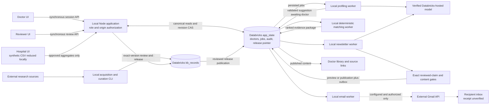

# MSL · Personalized oncology evidence briefings

Busy oncology specialists need to understand whether new evidence is relevant to the patients they treat, while preserving source traceability and uncertainty.

MSL combines doctor-stated interests, consented aggregate practice data and reviewed research into a personalized, cited evidence briefing. The doctor reviews generated profile suggestions and decides whether practice changes. A cohort percentage describes relevance, not complete trial eligibility.

## Demo scope

This is a **local hackathon demo connected to Databricks**. Lung oncology is the primary persona; the synthetic doctor setup also includes Breast. Onboarding supports Lung, Breast, Pancreas, Liver, Gastric, Colorectal and Other. The recorded research collection has 15 Lung candidates (8 NSCLC, 7 SCLC) and one candidate in each other family, including melanoma under Other. All 21 were pending review in the latest read-only receipt. An existing published release with zero approved items is intentional.

Hospital panels and doctor accounts are synthetic. Research candidates come from real Europe PMC indexed sources, with limited source excerpts and explicit unknowns. No official ESMO abstract feed, full-text research collection or completed clinical review is claimed. Audio preferences exist; audio output is outside this demo.

## System overview



Solid application requests are synchronous; worker arrows are independent persisted handoffs, even though the local runner polls them serially. Raw synthetic CSV stays in the hospital browser processing boundary. Databricks hosts storage/model services; the frontend, API, CLI and workers run locally. [Architecture overview and sequence](docs/architecture/overview.md).

Component guides: [doctor application](src/routes/README.md), [platform](src/lib/msl/platform/README.md), [hospital sync](src/lib/msl/hospital/README.md), [profiling](src/lib/msl/profiling/README.md), [research KB](kb/README.md), [matching](src/lib/msl/matching/README.md), [newsletter](src/lib/msl/newsletter/README.md), [email](src/lib/msl/delivery/README.md).

## Technical stack and rationale

| Technology                                                  | Actual responsibility and tradeoff                                                                                                                                            |
| ----------------------------------------------------------- | ----------------------------------------------------------------------------------------------------------------------------------------------------------------------------- |
| React 19.2 range, TanStack Start 1.168.60 / Router 1.170.41 | Existing file-based UI and Node API in one application; shared types avoid artificial service splits. Preserve the existing Lovable integration.                              |
| TanStack Query 5.101 range, Tailwind 4.2 range, Radix UI    | Async UI refresh, utility styling and existing accessible primitives; no second frontend.                                                                                     |
| TypeScript 5.8 range and Zod 3.25 range                     | Shared contracts and strict runtime validation; compile-time types alone cannot validate model or SQL JSON.                                                                   |
| Databricks SQL Statement Execution API / Delta              | Canonical versioned state and KB, one-row revision CAS. JSON doctor documents simplify this small demo but impose size/concurrency limits and lack cross-record transactions. |
| Databricks-hosted `databricks-gpt-oss-20b`                  | Profile suggestions and structured newsletter claim selection; verify live hosting metadata before inference. Reject external-model proxies and unavailable verification.     |
| Versioned claims and explicit human review                  | Reconstruct source → claim → item → exact-version review → release. Human approval remains the content bottleneck.                                                            |
| Deterministic matching                                      | Auditable filters, exact aliases and reproducible scores; no embeddings, fuzzy eligibility or model ranking.                                                                  |
| Persisted local workers                                     | Slow inference and delivery have leases/retries outside browser requests. The runner is local, not a deployed scheduler.                                                      |
| Gmail REST API / OAuth                                      | Authorized test/live email transport, separate from inference. Acceptance cannot establish inbox receipt; ambiguous outcomes require reconciliation.                          |
| Vite 8.1.5, Nitro Node preset, Vitest 4.1 range             | Existing build and offline behavioral tests. PGlite/Drizzle migrations remain historical PostgreSQL baselines.                                                                |

Versions above are package declarations, not claims that every range is an exact lock. See [package.json](package.json), [bun.lock](bun.lock) and the [validation snapshot](docs/PACKAGING-VALIDATION.md) for installed versions and reproducibility limits.

## Repository map

| Path                                                                            | Contents                                                                                  |
| ------------------------------------------------------------------------------- | ----------------------------------------------------------------------------------------- |
| `src/routes`, `src/components/msl`                                              | Doctor, hospital and reviewer UI; same-app API and worker routes                          |
| `src/lib/msl/platform`, `src/integrations/databricks`                           | Server sessions, canonical state, SQL and hosted-model verification                       |
| `src/lib/msl/{profiling,hospital,patient-sync,matching,newsletter,delivery,kb}` | Shared runtime modules and contracts, not independent deployed services                   |
| `scripts`                                                                       | Local worker runner, provisioning, preview and explicitly named live checks               |
| `kb`                                                                            | Acquisition/curation/operator CLI, data, provenance, review queues and receipts           |
| `scripts/fixtures`, module test fixtures                                        | Explicitly fictional offline data; never canonical clinical evidence                      |
| `docs/architecture`, `docs/demo`                                                | Current reviewer/developer entry points                                                   |
| `docs/*.md`, `legacy`, `drizzle`, `supabase`                                    | Handoffs and original planning/retired implementations; banners distinguish current setup |

## Local quick start

Use Node **24.3+** (the documented scripts use Node environment-file loading and `node:util.parseEnv`), npm, and the supported Databricks CLI. Run all commands from this repository root. Existing checkout owners should reuse their ignored `.env.local` and accounts; regenerating account IDs creates different canonical identities.

```sh
npm install --package-lock=false
# First local setup only; creates server secrets and synthetic accounts, prints no passwords.
node --import tsx scripts/configure-databricks-local.ts
# Terminal 1
node --env-file=.env.local node_modules/vite/bin/vite.js dev --port 8081 --strictPort
# Terminal 2 (safe default: no email sending)
EMAIL_MODE=preview EMAIL_SEND_ENABLED=false node --env-file=.env.local --import tsx scripts/run-databricks-workers.ts
```

The install uses the existing manifest; `bun.lock` is the existing tracked lock, and no npm lock is supplied. `tsx` is currently installed transitively; clean-install reproducibility has not been reverified in packaging. Supported frozen Bun installation and remaining prerequisites are described in [setup](docs/demo/setup.md). No server can sign in until CLI OAuth and the matching canonical accounts exist. Initial schema/account provisioning and KB setup are **separate explicit live writes** in that guide, not startup side effects.

Open [doctor sign-in](http://localhost:8081/auth), [hospital](http://localhost:8081/hospital) and [review](http://localhost:8081/review). Keep `APP_ORIGIN` exactly equal to the origin used in the browser.

## Demo walkthrough

Follow [research approval → doctor confirmation → briefing → authorized email](docs/demo/walkthrough.md). It identifies current blockers and an honestly labeled cached synthetic preview. [Troubleshooting](docs/demo/troubleshooting.md) covers stale inputs, workers, citations, Databricks and Gmail.

## Status and limitations

| Boundary                              | Evidence at documentation snapshot, 31 October 2026                                                                                                                                                         |
| ------------------------------------- | ----------------------------------------------------------------------------------------------------------------------------------------------------------------------------------------------------------- |
| Implemented locally                   | Role sessions; doctor/library/hospital/review UI; canonical adapters; profile, match, newsletter and Gmail worker code; no-send preview, subscriptions, signed notification handling and reconciliation     |
| Recorded live Databricks verification | App state and KB tables, synthetic profile inference, authorized app/reviewer reads, empty clinical release readback. Receipts do not establish perpetual availability.                                     |
| Recorded newsletter inference         | [Recorded synthetic inference](docs/evidence/synthetic-newsletter-inference.json): synthetic fixture, verified hosted inference, **zero Gmail send calls**, no clinical publication                         |
| Actually demonstrated end to end      | No recorded human-approved clinical release → real cited newsletter → inbox receipt. Do not present this as completed.                                                                                      |
| Pending for full demo                 | Genuine human reviews; nonempty released evidence; doctor consent/snapshot/confirmation as needed; authorized recipient registry, Gmail OAuth, local HTTPS origin and subscription                          |
| Future / outside local scope          | Production identity/deployment, distributed rate limits, hosting/schedules, real EHR ingestion, reliable retraction recall, archival, exact clinical eligibility, audio and specialty-aware multi-family v2 |

Current code couples library publication to send-ready configuration and subscription; preview mode stores a generation result/outbox preview, not a published library newsletter. KB and doctor records are separate: checks fence stale work, but there is no distributed transaction or exactly-once email guarantee.

## Privacy, security and contribution

Only synthetic hospital data is allowed. Raw rows stay in the hospital processing boundary; the backend accepts strict aggregates. Profile-model inputs exclude practice percentages; newsletter-model inputs include stated cancer/topic interests and reviewed claims. Email excludes patient mix, doctor codes and hospital assignments. Consent revocation immediately blocks current use; relinking requires a fresh snapshot and confirmation.

Credentials, password hashes and session secrets belong in ignored server files/secret storage. Never add `.env*` (except sanitized `.env.example`), local credentials, OAuth tokens or private logs. There is no public signup. This is a local demo authentication design.

Read [AGENTS.md](AGENTS.md), [data-platform decision](docs/DATA-PLATFORM-DECISION.md), [project context](docs/MSL-PROJECT-CONTEXT.md) and [project plan](docs/PROJECT-PLAN.md) before component work. Use current architecture pages over historical setup paragraphs. Preserve concurrent changes; run relevant tests before proposing a commit. No blanket project code license has been selected; research excerpts and dependencies retain their own rights. [Licensing and provenance](docs/LICENSING.md).

The existing remote is `C-Harshul/screenshot-exact-match`; its Lovable connection is preserved. [Repository handoff](docs/REPOSITORY-HANDOFF.md) records packaging decisions. No commit or push is implied by this documentation.
