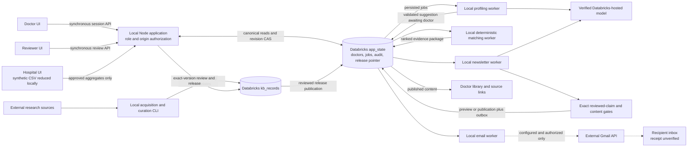

# PraxisRx

**Relevant medical evidence, explained for the patients you treat.**

PraxisRx helps healthcare professionals keep up with research, see why it matters to their practice, and follow the sources. **A person always decides what changes in their practice.**

[Demo walkthrough](docs/demo/walkthrough.md) · [Local setup](docs/demo/setup.md) · [Architecture](docs/architecture/overview.md) · [Code navigation](#start-reading-here)

## Why it matters

Knowing a treatment exists is only the beginning. Clinicians need to understand the evidence, weigh uncertainty, and see how it relates to their own patients—all within a busy workday. PraxisRx aims to make that learning more relevant and easier to act on.

## How it works

1. **Understand the practice.** The clinician shares their specialty and interests, optionally links consented patient aggregates, and reviews their generated profile.
2. **Find relevant evidence.** Reviewed research is matched to that profile with clear reasons for each selection.
3. **Deliver a cited briefing.** A short newsletter links to sources and explains the evidence and its limits. The clinician decides whether it changes their practice.

## Meet Ananya: the demo

Dr. Ananya Rao is a synthetic lung oncologist with little time to follow every new publication. She confirms her interests, her hospital publishes an approved aggregate patient snapshot, and her briefing brings together relevant reviewed research with source links and practice context.

The local demo includes three workspaces: **doctor**, **hospital**, and **evidence reviewer**. The app still uses its earlier working name, **MSL**, in screens and code.

## What works today—and what is planned

| Available in the local demo | Planned |
| --- | --- |
| Doctor onboarding, editable profiles and human confirmation | Broader support for doctors, nurses, physician assistants and other healthcare professionals |
| Synthetic hospital uploads and consented aggregate practice context | Production EHR integration and prescribing-pattern gap analysis |
| Human evidence review, deterministic matching, cited written briefings and an in-app library | Document export, personalized podcasts, videos and slides |
| Authorized Gmail sending with recorded provider outcomes | CME-linked learning and evaluation of patient outcomes |

**Recorded demo status · 31 October 2026:** the shared project plan records a six-item reviewed release, Ananya's confirmed profile and enriched synthetic aggregate snapshot, a published revised briefing, and one-time Gmail acceptance. Inbox receipt remains unverified. These are recorded results, not a fresh live availability check. See the [project handoffs](docs/PROJECT-PLAN.md#praxisrx-readme-refresh--31-october-2026).

## Built for trust

- **Human judgment:** experts review evidence before release; clinicians review their profiles and decide what changes in practice.
- **Traceable content:** clinical text is constrained to reviewed claims, with source links and versioned provenance.
- **Honest relevance:** cohort context explains why evidence may matter; it does not establish complete trial eligibility or prescribe treatment.
- **Patient privacy:** this build uses synthetic data only. Raw patient rows stay in the hospital processing boundary; only approved aggregates reach the app, and patient context is excluded from inference and email.

## Run or explore

Start with the [local setup guide](docs/demo/setup.md) for prerequisites, server configuration, synthetic accounts and safe preview commands. Existing checkout owners should reuse their local configuration and account identities.

**Stack:** React + TanStack Start + TypeScript; Databricks for canonical data and verified hosted inference; Gmail for authorized email. The app and workers run locally. Supabase is retired from the active runtime.

This is a hackathon demo. Production identity, hosting, scheduling, real EHR integration and demonstrated clinical outcome improvements remain outside its current scope.

<details>
<summary><strong>Developer guide: architecture, stack, code map and quick start</strong></summary>

## System overview



Solid application requests are synchronous; worker arrows are independent persisted handoffs, even though the local runner polls them serially. Raw synthetic CSV stays in the hospital browser processing boundary. Databricks hosts storage/model services; the frontend, API, CLI and workers run locally. [Architecture overview and sequence](docs/architecture/overview.md).

Component guides: [doctor application](src/routes/README.md), [platform](src/lib/msl/platform/README.md), [hospital sync](src/lib/msl/hospital/README.md), [profiling](src/lib/msl/profiling/README.md), [research KB](kb/README.md), [matching](src/lib/msl/matching/README.md), [newsletter](src/lib/msl/newsletter/README.md), [email](src/lib/msl/delivery/README.md).

## Technical stack and rationale

| Technology                                                  | Actual responsibility and tradeoff                                                                                                                                            |
| ----------------------------------------------------------- | ----------------------------------------------------------------------------------------------------------------------------------------------------------------------------- |
| React 19.2 range, TanStack Start 1.168.60 / Router 1.170.41 | Existing file-based UI and Node API in one application; shared types avoid artificial service splits. Preserve the existing Lovable integration.                              |
| TanStack Query 5.101 range, Tailwind 4.2 range, Radix UI    | Async UI refresh, utility styling and existing accessible primitives; no second frontend.                                                                                     |
| TypeScript 5.8 range and Zod 3.25 range                     | Shared contracts and strict runtime validation; compile-time types alone cannot validate model or SQL JSON.                                                                   |
| Databricks SQL Statement Execution API / Delta              | Canonical versioned state and KB, one-row revision CAS. JSON doctor documents simplify this small demo but impose size/concurrency limits and lack cross-record transactions. |
| Databricks-hosted `databricks-gpt-oss-20b`                  | Profile suggestions and structured newsletter claim selection; verify live hosting metadata before inference. Reject external-model proxies and unavailable verification.     |
| Versioned claims and explicit human review                  | Reconstruct source → claim → item → exact-version review → release. Human approval remains the content bottleneck.                                                            |
| Deterministic matching                                      | Auditable filters, exact aliases and reproducible scores; no embeddings, fuzzy eligibility or model ranking.                                                                  |
| Persisted local workers                                     | Slow inference and delivery have leases/retries outside browser requests. The runner is local, not a deployed scheduler.                                                      |
| Gmail REST API / OAuth                                      | Authorized test/live email transport, separate from inference. Acceptance cannot establish inbox receipt; ambiguous outcomes require reconciliation.                          |
| Vite 8.1.5, Nitro Node preset, Vitest 4.1 range             | Existing build and offline behavioral tests. PGlite/Drizzle migrations remain historical PostgreSQL baselines.                                                                |

Versions above are package declarations, not claims that every range is an exact lock. See [package.json](package.json), [bun.lock](bun.lock) and the [validation snapshot](docs/PACKAGING-VALIDATION.md) for installed versions and reproducibility limits.

## Repository map

| Path                                                                            | Contents                                                                                  |
| ------------------------------------------------------------------------------- | ----------------------------------------------------------------------------------------- |
| `src/routes`, `src/components/msl`                                              | Doctor, hospital and reviewer UI; same-app API and worker routes                          |
| `src/lib/msl/platform`, `src/integrations/databricks`                           | Server sessions, canonical state, SQL and hosted-model verification                       |
| `src/lib/msl/{profiling,hospital,patient-sync,matching,newsletter,delivery,kb}` | Shared runtime modules and contracts, not independent deployed services                   |
| `scripts`                                                                       | Local worker runner, provisioning, preview and explicitly named live checks               |
| `kb`                                                                            | Acquisition/curation/operator CLI, data, provenance, review queues and receipts           |
| `scripts/fixtures`, module test fixtures                                        | Explicitly fictional offline data; never canonical clinical evidence                      |
| `docs/architecture`, `docs/demo`                                                | Current reviewer/developer entry points                                                   |
| `docs/*.md`, `legacy`, `drizzle`, `supabase`                                    | Handoffs and original planning/retired implementations; banners distinguish current setup |

### Start reading here

The repository is one application with feature modules. Routes describe URLs; components render screens; hooks manage browser requests/state; server modules enforce domain rules and persistence. Follow one feature from its route to its worker rather than reading directories alphabetically.

| What you want to understand or change          | Start here                                                                                                                                                                                                          | Then follow                                                                                                                                                                                                                                                                                                                           |
| ---------------------------------------------- | ------------------------------------------------------------------------------------------------------------------------------------------------------------------------------------------------------------------- | ------------------------------------------------------------------------------------------------------------------------------------------------------------------------------------------------------------------------------------------------------------------------------------------------------------------------------------- |
| Doctor profile screen                          | [profile route](src/routes/_authenticated/_onboarded/profile.tsx) and [GeneratedProfile](src/components/msl/GeneratedProfile.tsx)                                                                                   | [browser API](src/lib/msl/api.ts) → [app API route](src/routes/api.app.ts) → [doctor dispatcher](src/lib/msl/platform/doctor.server.ts)                                                                                                                                                                                               |
| Profile edits, doctor confirmation and retries | [doctor-profile.server.ts](src/lib/msl/platform/doctor-profile.server.ts)                                                                                                                                           | [profile-state.ts](src/lib/msl/platform/profile-state.ts) queues/supersedes versions; [store.server.ts](src/lib/msl/platform/store.server.ts) commits them                                                                                                                                                                            |
| Profile generation                             | [profiling worker](src/lib/msl/profiling/worker.server.ts)                                                                                                                                                          | [lifecycle.server.ts](src/lib/msl/profiling/lifecycle.server.ts) claims/completes jobs → [Databricks adapter](src/lib/msl/profiling/databricks.server.ts) → [profile contract](src/lib/msl/profiling/contract.ts) validates output                                                                                                    |
| Consent/linking or library reads               | [doctor-consent.server.ts](src/lib/msl/platform/doctor-consent.server.ts), [doctor-queries.ts](src/lib/msl/platform/doctor-queries.ts), [doctor-activity.server.ts](src/lib/msl/platform/doctor-activity.server.ts) | The dispatcher runs mutations plus audit inside one canonical revision CAS                                                                                                                                                                                                                                                            |
| Hospital upload screen                         | [hospital route](src/routes/hospital.tsx) → [HospitalPortal](src/components/msl/hospital/HospitalPortal.tsx)                                                                                                        | [useHospitalPortal](src/components/msl/hospital/useHospitalPortal.ts) owns requests/file state; [PatientUpload](src/components/msl/hospital/PatientUpload.tsx) and [AggregatePreview](src/components/msl/hospital/AggregatePreview.tsx) render upload/review controls                                                                 |
| Hospital publication rules                     | [hospital API](src/routes/api.hospital.ts)                                                                                                                                                                          | [hospital service](src/lib/msl/hospital/service.server.ts) → [publication.server.ts](src/lib/msl/hospital/publication.server.ts) → canonical doctor store                                                                                                                                                                             |
| Research review screen                         | [review route](src/routes/review.tsx) → [ReviewPage](src/components/msl/review/ReviewPage.tsx)                                                                                                                      | [useEvidenceReview](src/components/msl/review/useEvidenceReview.ts) coordinates requests; [CandidateDirectory](src/components/msl/review/CandidateDirectory.tsx), [CandidateReview](src/components/msl/review/CandidateReview.tsx), [ReleasePublication](src/components/msl/review/ReleasePublication.tsx) render each workflow stage |
| Research acquisition/review/release rules      | [KB CLI](kb/operate.ts), [review API](src/routes/api.review.ts)                                                                                                                                                     | [review service](src/lib/msl/kb/review.server.ts), [core contracts](src/lib/msl/kb/core.ts) and [canonical KB store](src/lib/msl/kb/store.server.ts)                                                                                                                                                                                  |
| Evidence ranking                               | [matching worker](src/lib/msl/matching/worker.server.ts)                                                                                                                                                            | [deterministic algorithm](src/lib/msl/matching/contract.ts) → [ranked package](src/lib/msl/matching/handoff.ts)                                                                                                                                                                                                                       |
| Newsletter content and email                   | [newsletter worker](src/lib/msl/newsletter/worker.server.ts), [delivery worker](src/lib/msl/delivery/worker.server.ts)                                                                                              | [content gates](src/lib/msl/newsletter/content.ts), [Gmail adapter](src/lib/msl/delivery/gmail.server.ts), and their component READMEs                                                                                                                                                                                                |
| Background execution                           | [run-databricks-workers.ts](scripts/run-databricks-workers.ts)                                                                                                                                                      | Calls each feature's worker; persisted canonical state is the handoff between them                                                                                                                                                                                                                                                    |

For doctor profiling, read **`worker.server.ts` → `lifecycle.server.ts` → `databricks.server.ts` → `contract.ts`**. The worker shows the orchestration; lifecycle functions contain state transitions; the adapter owns verified model transport; the contract owns deterministic validation. Doctor edits/confirmation are separate from model execution in `platform/doctor-profile.server.ts`.

### Module conventions

- `src/routes/` contains TanStack route configuration and API boundaries. The hospital/review routes delegate screen rendering to feature components.
- `src/components/msl/<feature>/` contains page composition, focused sections and `use<Feature>` hooks. Hooks own request state and retry identity; sections use typed props and retain human approval/confirmation controls.
- `*.server.ts` contains server-only orchestration, domain mutations or external integrations. Keep credentials and canonical writes here. Pure contracts/projections do not need server access.
- `contract.ts`, `types.ts` and pure helpers define shared data/validation. `api.ts` and `queries.ts` connect browser consumers to authorized endpoints.
- Tests live beside the behavior they protect (`*.test.ts` / `*.test.tsx`). Start with the feature's tests before changing leases, consent, publication or retries; use [offline check commands](docs/demo/setup.md#offline-verification).

Keep each module responsible for a named stage of the existing workflow. Domain helpers mutate the state supplied by the canonical transaction callback; they must not introduce separate writes that split consent, audit and jobs across commits. Historical `legacy/`, `supabase/` and PostgreSQL migrations are reference material, not alternate active paths.

## Local quick start

Use Node **24.3+** (the documented scripts use Node environment-file loading and `node:util.parseEnv`), npm, and the supported Databricks CLI. Run all commands from this repository root. Existing checkout owners should reuse their ignored `.env.local` and accounts; regenerating account IDs creates different canonical identities.

```sh
npm install --package-lock=false
# First local setup only; creates server secrets and synthetic accounts, prints no passwords.
node --import tsx scripts/configure-databricks-local.ts
# Terminal 1
node --env-file=.env.local node_modules/vite/bin/vite.js dev --port 8081 --strictPort
# Terminal 2 (safe default: no email sending)
EMAIL_MODE=preview EMAIL_SEND_ENABLED=false node --env-file=.env.local --import tsx scripts/run-databricks-workers.ts
```

The install uses the existing manifest; `bun.lock` is the existing tracked lock, and no npm lock is supplied. `tsx` is declared directly; clean-install reproducibility has not been reverified in packaging. Supported frozen Bun installation and remaining prerequisites are described in [setup](docs/demo/setup.md). No server can sign in until CLI OAuth and the matching canonical accounts exist. Initial schema/account provisioning and KB setup are **separate explicit live writes** in that guide, not startup side effects.

Open [doctor sign-in](http://localhost:8081/auth), [hospital](http://localhost:8081/hospital) and [review](http://localhost:8081/review). Keep `APP_ORIGIN` exactly equal to the origin used in the browser.

## Design and visual validation

The app uses a shared clinical reading desk design across doctor, hospital and reviewer workspaces. See [design direction, references, screen inventory, screenshots and validation](docs/design/CLINICAL-READING-DESK.md). Existing consent, human review, canonical publication and Gmail acceptance semantics are preserved.

## Demo walkthrough

Follow [research approval → doctor confirmation → briefing → authorized email](docs/demo/walkthrough.md). It includes the original demo prerequisites and a labeled cached synthetic preview; consult the latest shared handoffs above for subsequently recorded live results. [Troubleshooting](docs/demo/troubleshooting.md) covers stale inputs, workers, citations, Databricks and Gmail.


</details>

<details>
<summary><strong>Contributor notes: privacy, security and licensing</strong></summary>

## Privacy, security and contribution

Only synthetic hospital data is allowed. Raw rows stay in the hospital processing boundary; the backend accepts strict aggregates. Profile-model inputs exclude practice percentages; newsletter-model inputs include stated cancer/topic interests and reviewed claims. Email excludes patient mix, doctor codes and hospital assignments. Consent revocation immediately blocks current use; relinking requires a fresh snapshot and confirmation.

Credentials, password hashes and session secrets belong in ignored server files/secret storage. Never add `.env*` (except sanitized `.env.example`), local credentials, OAuth tokens or private logs. There is no public signup. This is a local demo authentication design.

Read [AGENTS.md](AGENTS.md), [data-platform decision](docs/DATA-PLATFORM-DECISION.md), [project context](docs/MSL-PROJECT-CONTEXT.md) and [project plan](docs/PROJECT-PLAN.md) before component work. Use current architecture pages over historical setup paragraphs. Preserve concurrent changes; run relevant tests before proposing a commit. No blanket project code license has been selected; research excerpts and dependencies retain their own rights. [Licensing and provenance](docs/LICENSING.md).

The existing remote is `C-Harshul/screenshot-exact-match`; its Lovable connection is preserved. [Repository handoff](docs/REPOSITORY-HANDOFF.md) records packaging decisions. No commit or push is implied by this documentation.

</details>
