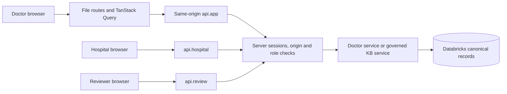

# Doctor application and authentication

The doctor records stated interests, links consented synthetic practice context, confirms generated suggestions and reads canonical newsletters/articles/bookmarks. Hospital staff and evidence reviewers use separate role cookies in the same application.

**Entry points:** `src/routes/auth.tsx`, `_authenticated/route.tsx`, `_authenticated/onboarding.tsx`, `_authenticated/_onboarded/profile.tsx`, library routes; `/hospital`, `/review`; `src/lib/msl/api.ts`, `queries.ts`, `platform/auth.server.ts`, `doctor.server.ts`. All browser reads/mutations use the typed API, never browser SQL. `/patient-sync` redirects to `/hospital`. `routeTree.gen.ts` is generated.

**Inputs/outputs:** provisioned server accounts authenticate into eight-hour signed HttpOnly SameSite=Strict cookies, with Secure on HTTPS. Stated fields and consent mutations update `msl-app-state.v1` doctor documents; API responses are owner-scoped projections. Password hashes use scrypt; removing an account/changing its hash invalidates cookies. No public signup. Hospital assignments live in canonical doctor documents; reviewer identity additionally requires registry/allowlist membership.

**Lifecycle and failures:** requests are synchronous through acknowledgment; profile work is queued in persisted state, not executed in the UI. Unfinished onboarding redirects. Origin/role/session errors deny access. Canonical failures surface without fixture fallback. Unlink clears active context and supersedes the profile; hospital staff cannot confirm it. Explicit article-open audit records are reading activity, not proof of comprehension.

**Configuration:** `APP_ORIGIN`, `APP_SESSION_SECRET`, `APP_ACCOUNTS_JSON`; server Databricks variables from the platform guide. Reviewer additionally uses `KB_AUTHORIZED_REVIEWERS`, `KB_REVIEWER_REGISTRY_JSON`. Never set these as `VITE_*` variables.

**Choices:** existing React/TanStack Start file routing and Query cache retain one runtime and shared contracts; Tailwind/Radix retain the existing UI. Demo sessions avoid a second active data/auth platform, at the cost of manual account provisioning and an in-process rate limiter.

**Run/test:** follow [setup](../demo/setup.md); open `/auth`, `/hospital`, `/review`. `npm test`, `npx tsc --noEmit`, `npm run build` exercise application behavior. Session and doctor-service tests live under `src/lib/msl/platform`; hospital/review page tests sit beside their modules. Recorded live sign-in/read/role/origin checks passed in prior handoffs; no hosted identity service, deployment or distributed limiter was provisioned.
