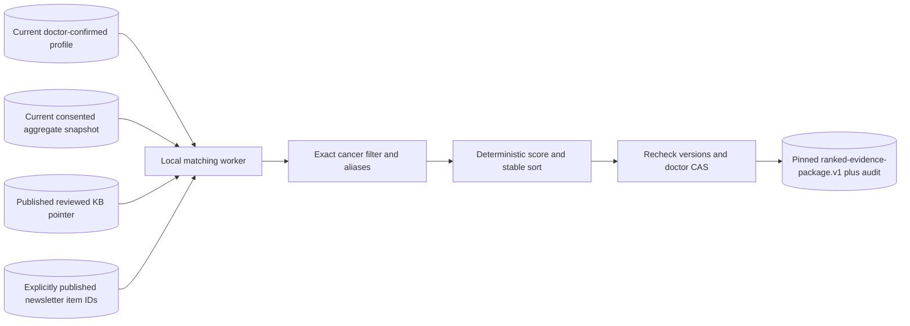

# Deterministic evidence matching

Rank reviewed evidence reproducibly using confirmed interests and consented aggregate cohorts. Matching does not call an LLM, generate text or send email.

**Entry points:** `matching/{contract,worker.server,kb.server,handoff,handoff.server}.ts`, `/api/matching/run`. Full [handoff](../MATCHING.md).

**Input/output:** strict `matching-kb.v1` reviewed release plus current confirmed `doctor-profile.v1` stated fields/reviewed focus, current numeric consented aggregates and published item IDs. A canonical `matching_runs[]` entry persists `ranked-evidence-package.v1`, `matching.v1`, input doctor revision, profile/snapshot versions, KB pointer revision, reasons and ranked evidence. `readCurrentRankedPackage` rejects changed/unconfirmed inputs, replaced/disabled evidence and historical runs without the package. Failure never substitutes local KB fixtures.

**Algorithm:** exclude already-published item IDs and cancer families absent from stated selections. Topics boost ranking, rather than excluding. Score = `100 * (cohort_percent ?? 0) + 2 * distinct_selected_topic_count + 1_if_confirmed_focus_matches`. Sort descending score, known cohort before unknown at ties, then ascending stable item ID. `POPULATION_LABELS` lists exact permitted aliases; unknown or conflicting aliases remain null. There is no fuzzy, embedding or specialty-field matching. Cancer-family filter name `outside_specialty` should not be read as actual specialty filtering.

Cohort share is potential relevance, not complete eligibility: `applicability_percent` remains null, even for a known cohort. Never multiply marginal percentages. A known zero differs from unknown.

**Trigger/lifecycle:** first current confirmed profile is due immediately; later runs use 7/14 elapsed-day cadence, with changed confirmed profile or missing valid package due immediately. One due doctor per invocation. Worker rechecks current pointer before commit; failure/conflict does not advance successful cadence. There is a cross-record invalidation race after separate checks, not a KB/doctor distributed transaction.

**Suppression:** only canonical `publication.status=published` library articles suppress stable KB item IDs across versions. Matching, preview, Gmail acceptance, delivery and reading do not. Published content remains suppressed when email fails; retry the same newsletter/task. `sent_at` is not delivery evidence.

**Configuration/run/tests:** shared Databricks variables and `LOVABLE_CRON_SECRET`; local common runner or authenticated `POST /api/matching/run`. `npm test -- src/lib/msl/matching` tests schema/scoring/handoff/staleness/worker behavior. [Synthetic trace](../../kb/exports/synthetic-worked-example.json) is fictional and cannot enter clinical release. Current recorded live release is empty; ranking real approved clinical items end to end remains pending human review. Determinism is chosen for auditability at the cost of no inferred semantic recall.
