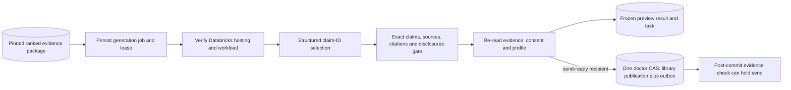

# Newsletter generation and publication

Turn a current ranked evidence package into a cited briefing without allowing invented clinical prose. The model selects and orders approved claim IDs; deterministic rendering copies exact reviewed statements.

**Files:** `newsletter/{worker.server,databricks.server,content,context.server,state.server,frozen,publication,api.server,types}.ts`; `/api/newsletter/run`; `scripts/preview-newsletter.ts`; `NewsletterDelivery.tsx`.

**Contracts:** consumes current `ranked-evidence-package.v1`; model returns `newsletter-selection.v1` IDs; prompt same version, gate `exact-reviewed-claims.v1`; output provenance `newsletter.v1`. Stores jobs/result in `newsletter_jobs` and published newsletter/articles/citations in canonical doctor state. Provenance includes input hash, matching run, profile/patient snapshot, KB revision/release, exact claim/source/review versions, hosting, token usage and latency.

**Gates:** include exactly the selected first <=12 matched items, valid supplied claim IDs, strict schema and unique identities. Summary/body text is copied from approved claims with numbered HTTPS sources. Meaningful funding/status disclosures must themselves be exact reviewed claims; absent eligibility/exclusions are labeled unspecified. Frozen content is revalidated before publication. Model inputs contain selected cancer/topic interests and reviewed claim text, not patient mix or doctor identity. Hosting verification uses the shared server guard. The newsletter adapter separately restricts the endpoint/structured task and records `newsletter-exact-claim-selection.v1` workload provenance; hosting metadata does not prove clinical capability. No external fallback.

These gates validate constrained content/provenance, not whether an expert's reviewed claim follows from the original study or applies clinically. They do not establish semantic entailment or replace human review.

**Lifecycle:** one stable generation/newsletter identity per doctor/matching run, five-minute lease, max three drafting attempts with increasing minute retry delays. Lease/input checks supersede stale work. Preview retains frozen validated content for later reuse; cached promotion must pass fresh input checks. A preview is not published and does not suppress evidence.

**Current coupling:** the worker publishes to the library **only when** send configuration is valid, recipient matches canonical metadata. Subscription independently controls the email task: unsubscribed/suppressed doctors still receive the in-app publication with a cancelled email task. Otherwise it stores a no-send preview/result/task. Published library plus durable outbox is one doctor CAS; KB pointer checks before/after remain separate. A changed pointer after publication can hold sending without recalling historical library content. Publication failure/ambiguity requires canonical readback, not duplicate newsletters. Failed draft attempts cannot be reset through the UI retry action; new valid work/input is needed after diagnosis.

**Configuration:** `NEWSLETTER_MODEL_ENDPOINT=databricks-gpt-oss-20b`, shared Databricks/session/cron settings, plus delivery configuration for publication. Run common worker or protected `/api/newsletter/run`. `npm run preview:newsletter` creates offline fictional HTML/text under ignored artifacts, with no canonical write/model/email call. `--live-model` is an explicit inference operation, unnecessary for documentation validation.

**Tests/status:** `npm test -- src/lib/msl/newsletter`, `npm run check:newsletter-scripts`. Recorded synthetic fixture inference succeeded with verified `system.ai.gpt-oss-20b`, 2,926 ms and 764 tokens in the local receipt, with no clinical publication and zero email calls. Empty clinical KB prevents a real reviewed newsletter demonstration. See [walkthrough](../demo/walkthrough.md) for honest caching.
