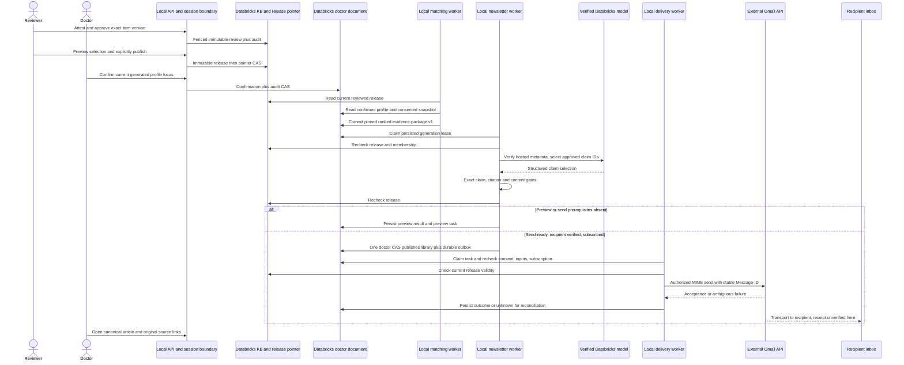

# Current architecture

Snapshot: 31 October 2026. [Root system diagram](../../README.md#system-overview) shows deployment boundaries. All frontend/API/worker execution is local; only canonical SQL/Delta storage and verified model serving are remote Databricks services. External research retrieval and Gmail are separate dependencies. There is one app, not eight microservices.

[Doctor application](doctor-application.md) → [hospital aggregates](hospital-patient-sync.md) → [profile confirmation](doctor-profiling.md) and [reviewed KB](research-knowledge-base.md) → [deterministic matching](evidence-matching.md) → [newsletter](newsletter-generation.md) → [email](email-delivery.md), using the shared [platform](databricks-platform.md).

Browser requests authenticate and validate synchronously, then return acknowledged canonical state. Workers consume persisted state independently. The local runner calls profiling, matching, newsletter, delivery and notifications serially every loop, sleeping 30 seconds after the loop; long SQL/model calls can lengthen cadence. A browser page is never the worker scheduler.

## Approval-to-inbox sequence

This is the implemented protocol and its conditional email path, **not a recorded completed clinical demonstration**. Latest reviewer receipt contains zero approvals and zero clinical items. Each step after that boundary needs its real prerequisite.

## Guarantees and limits

Doctor state, outbox and audit share one row CAS, not a transaction spanning KB or Gmail. A release can change between separate checks and a send. Notification messages mean sender mailbox changes, not recipient delivery. Stable keys and no-blind-resend handling reduce duplicates without promising exactly once. Explicit published library markers suppress evidence; provider acceptance and reading do not.

No raw patient pipeline into Databricks bronze/silver/gold tables is implemented in this repository. The active hospital path aggregates synthetic CSV in the browser or uploads a strict approved aggregate JSON. Older layering proposals remain historical context. KB extraction currently uses deterministic rules, not an LLM or embedding search.

## Recorded evidence

- [KB live review readback](../../kb/exports/live-review-ui-readback.json): 21 pending, zero approved/rejected, published empty release; no decisions made by verification.
- [KB release receipt](../../kb/exports/live-release-receipt.json) and other `live-*.json`: dated canonical readback/hashes.
- [Synthetic newsletter inference receipt](../evidence/synthetic-newsletter-inference.json) is a sanitized copy of the existing ignored artifact sidecar; it is not clinical publication or email receipt. Packaging did not repeat that inference.
- [Historical handoffs and source decision](../DATA-PLATFORM-DECISION.md) preserve what was checked by each owner. Packaging performs offline checks only; it does not approve evidence, send email or modify canonical records.
