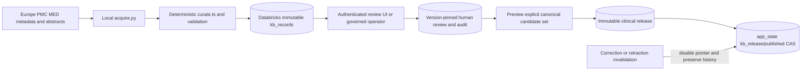

# Research KB, review and publication

This is part of the shared local application, not a separately deployed service.

[Component architecture, diagram, inputs/outputs, versions, entry points, canonical records, configuration, run/test steps and failure behavior](../docs/architecture/research-knowledge-base.md).

[Local setup](../docs/demo/setup.md) · [Demo walkthrough](../docs/demo/walkthrough.md) · [System overview](../docs/architecture/overview.md).

Acquire source-grounded research candidates, preserve exact lineage and publish only exact versions approved by a human. A real source does not make the extracted candidate a reviewed clinical finding.

**Entry points:** `kb/acquire.py`, `curate.ts`, `operate.ts`; `src/lib/msl/kb/{core,store.server,review.server,review-contract,http.server}.ts`; `/review`, `/api/review`; `kb/sql/setup.sql`. [Coverage](RESEARCH-COVERAGE.md) and [detailed handoff](../docs/KNOWLEDGE-BASE.md).

**Coverage:** recorded 333 discovery documents, 23 canonical documents, 21 claims/items, 15 Lung and one each other supported family. Search window 1 August–30 October 2026; first publication differs from retrieval time. Two older pivotal reports are context. Partial other-family acquisition has no completed watermark. Only metadata and <=24 abstract words per source retained; no full-text ingestion, ESMO results, guidelines/regulatory/registry connector or exhaustive rare-cancer coverage. Funding, full eligibility and numeric treatment contexts remain explicitly unverified. Original excerpts/metadata retain source rights.

**Lineage/contracts:** source/document version → exact claim/source locator → candidate item version/snapshot hash → explicit candidate-set membership → review decision → immutable release/manifest → strict `matching-kb.v1` pointer payload. Rich schema definitions and hashes live in `core.ts`; the matching contract allows one cancer family per item. Multi-family candidates require a coordinated v2/justified children, not silent first-family selection. Tables are `kb_records` and the app-state published pointer; `kb_<kind>` views are read-only. Pending, approved and published are distinct.

**Review:** `/review` implements authenticated list/detail/filter, exact-version approve/reject, note/attestation, release preview and explicit publication. Reviewer role plus server account-to-reviewer registry and allowlist controls identity; publish privilege is separate. Rejection wins for an exact version. Changed source/item/claim needs new review. Fingerprints, request IDs, pointer lease fencing and canonical readback reject stale/ambiguous operations; UI does not grant authority merely by knowing an item ID. Operator CLI remains an administrative alternative, not an identity-provider signature.

**Lifecycle:** acquisition uses overlapping windows, bounded retries and partial/quarantine status; no scheduler is deployed. Deterministic title classification/excerpt extraction was used; no KB LLM extraction ran. If introduced, it must use verified Databricks-hosted inference and retain human review. `sync` inserts immutable versions; release builds from canonical records/reviews, records immutable history then CAS advances the pointer. One governed writer at a time; no database-enforced uniqueness or distributed transaction is claimed. Correction/retraction events disable the current pointer; new reviewed versions restore service. Historical newsletter recall and automated retraction discovery remain gaps.

**Configuration:** shared Databricks settings, `KB_NAMESPACE`, `KB_AUTHORIZED_REVIEWERS`, `KB_REVIEWER_REGISTRY_JSON`, shared app session/origin/accounts. Provision a reviewer explicitly using `scripts/provision-kb-reviewer.ts --create`; the human must personally perform any review. Run commands in [setup](../docs/demo/setup.md); `python3 -m unittest discover -s kb -p test_acquire.py`, `npm test -- src/lib/msl/kb`, `npx tsc --noEmit --project kb/tsconfig.json`.

**Verified:** latest [live review receipt](exports/live-review-ui-readback.json) records authenticated canonical list/detail/preview and denials: 21 pending, zero approved, zero released clinical items, no decisions written. Prior receipts verify storage/release readback. Local UI/lease/release tests do not constitute live approval/publication.
