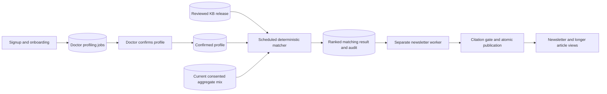

# Matching — asynchronous Job 4 input

## Canonical platform decision — supersedes storage placement below

Databricks workspace `https://dbc-85372395-9d08.cloud.databricks.com` (workspace ID `7474660613250664`) is the canonical source of truth for profile versions, approved aggregate snapshots, reviewed KB releases, match runs/reasons and briefing/publication provenance. Read the shared `docs/DATA-PLATFORM-DECISION.md` before further integration work. The Supabase implementation described below is the existing migration baseline; it is not connected canonical Databricks data.

Preserve existing queues, leases, owner isolation and immediate consent revocation. Supabase may serve explicitly published projections and operational pending writes. Before connecting Matching, define canonical dataset IDs/versions, authoritative writers, publication state, synchronization direction and idempotent acknowledgments. Matching must consume published compatible canonical versions; operational pending edits or unavailable synchronization must be visible and must not silently fall back to Supabase-only inputs. Match results and audit provenance require durable canonical publication before downstream use as published records.

Migration gaps: no Databricks connector, catalog/schema, compute, read adapter, canonical match writer or acknowledged projection bridge has been verified or implemented by Matching. `msl_demo` is only a proposed namespace. Existing `matching_kb_releases`, `matching_jobs`, `current_matching_input`, worker and reader RPCs currently operate solely on Supabase and therefore do not yet satisfy the target architecture. Unit fixtures and embedded Postgres checks remain offline verification. No hosted migration or data transfer follows from this decision. Do not bypass the console's automated-browser-control restriction or place Databricks credentials in browser code. Current operational denial/unlink must override stale canonical projections throughout the eventual bridge.

Implemented locally; no migration, scheduler, reviewed clinical KB release or deployment has been applied. This workstream owns matching. The separate newsletter worker owns drafting, citation validation and atomic publication.

There are no direct calls between profiling, matching and newsletter generation. Signup alone is insufficient: completed onboarding and a current successful, doctor-confirmed profile are required. Without confirmation or a released KB, matching stays idle. Patient linking remains optional.

## Queue, schedule and snapshots

`POST /api/matching/run` accepts the same server bearer secret as profiling (`LOVABLE_CRON_SECRET`, previous secret supported during rotation). Each invocation enqueues due doctors and handles at most one matching job. Use a POST-capable scheduler, normally every minute. Default GET-only scheduling will not invoke it. The current app builds with Nitro's Cloudflare target; configure scheduling for the actual deployed host.

The first confirmed profile is due immediately. Later runs are due seven or fourteen days after the last successful match, according to the stated frequency; a newly confirmed profile or changed aggregate snapshot is due immediately. A new KB release by itself waits until the next due cycle. Failed work backs off five minutes. The bounded handler drains one job per invocation; large deployments should batch the enqueue scan and increase worker concurrency.

Each job pins profile ID/version/schema/prompt/model, stated fields, doctor-reviewed focus pairs, consented aggregate timestamp/content, KB release ID, delivered KB IDs and matcher version. Names and doctor codes are excluded from the input; aggregate keys and numeric percentages are validated. The immutable KB release pins every item, claim, source and review version. Claim provenance validation is structural; it does not independently verify source truth or clinical entailment.

Enqueue holds a doctor lock and allows one pending job per doctor. Workers use `SKIP LOCKED`, unique lease tokens, five-minute leases and at most three abandoned-lease attempts. Completion rechecks the current profile, aggregate mix and delivered IDs. Stale results are discarded and audited. Profile edits/link changes are additionally invalidated through profiling's existing supersession rules. A new KB release does not invalidate pinned historical runs; retractions remain outside the current scope.

`matching_jobs` is read-only and owner-scoped for authenticated doctors. Workers and KB publication are service-only. Audit entries append queue/start/success/failure/discard events, ranking scores, cohort percentages, population IDs, topic matches and reasons. Raw patient records are never part of this contract.

## Reviewed KB handoff

The existing app has no normalized KB tables. `matching_kb_releases` is an immutable adapter boundary, not an ingestion or review system. The KB workstream should export a complete reviewed release and call `publishMatchingRelease(payload)` from trusted server code. The Zod contract is in `src/lib/msl/matching/contract.ts`; the adapter validates before inserting through `publish_matching_kb_release`. Worker validation repeats before matching. The latest released version is selected for each new job. Do not use the raw RPC as a substitute for the validated adapter.

Release shape: `{ schema_version: "matching-kb.v1", items: [...] }`. An empty release is valid and yields an honest empty result. Every item requires:

- Stable `id`, `version`, `title`, `cancer_type`, `topics`, canonical `population_id` or null, `eligibility_definition_id` or null, and `eligibility_summary`.
- `status_flags`, `funding` (explicitly unknown when unknown), `reviewed_by`, and ISO `reviewed_at`.
- Nonempty `claims`: `{ id, claim_text, source_id, supporting_passage, location }`.
- Nonempty `sources`: `{ id, source_name, title, url, published_date }`; HTTPS URLs and nullable dates. Every claim must resolve to a supplied source. IDs must be unique within an item; item IDs unique within a release. Claim IDs are scoped to their article/item.

Use the existing cancer/topic vocabulary from `options.ts`. Lung subtypes normalize to `Lung` in the export; no fuzzy subtype guessing happens in matching. Cross-specialty additions are omitted in v1. The explicit `POPULATION_LABELS` map defines canonical IDs and accepted legacy patient-mix aliases. Unrecognized populations stay unknown; conflicting alias percentages stay unknown. This proposed vocabulary must be coordinated with the KB and patient-mix workstreams before live release.

## Ranking and applicability

Only items in the selected cancer types are retained. Stable KB item IDs found in previously published `articles.kb_item_id` are excluded across all versions. Matching alone never marks an item delivered. Historical demo articles without an ID cannot be safely deduplicated by title; the owning integration must backfill reviewed IDs if desired.

Score = `100 × cohort_percent (unknown uses 0) + 2 × distinct stated topic matches + 1 for a doctor-confirmed matching focus pair`. Known zero sorts ahead of unknown when scores tie, followed by stable item ID. All matching items are returned without an arbitrary top-N cap; the newsletter worker may apply a documented length policy. Zero and unknown remain distinct in the structured output. Neither is proof of full clinical eligibility.

**The current patient store contains labels and percentages without denominator or complete eligibility definitions. V1 therefore always returns `applicability_percent: null`.** A matched aggregate is emitted as `cohort_percent`, `applicability_kind: "cohort_only"`, meaning “potentially relevant cohort; full eligibility unknown.” Missing/unlinked/conflicting data produces a null cohort and `unknown`. No intersections are calculated and overlapping cohorts are never summed.

Before enabling exact “applies to X%” badges, the patient-mix workstream must provide versioned denominator and eligibility-definition IDs, and matching must verify those IDs against the evidence. Merely adding `eligibility_definition_id` to a KB item cannot establish an exact estimate against today's legacy mix.

## Newsletter integration requirements

1. Poll successful jobs and obtain a current input using the service-only `read_current_matching_result(job_id)`. It returns null for a stale profile, consent/mix or delivered-state change. The envelope includes the matching job ID, doctor, KB release, pinned input and ranked result. An empty match list is a successful “nothing new” cycle; do not invent content.
2. Use one durable generation job per matching job ID (unique constraint), so retries use the same ranked evidence. Pass only the selected evidence, stated profile and consented aggregates to the server-side LLM. Do not use unconfirmed suggested focus. The deterministic scores, percentages and reasons are authoritative and must not be overwritten by generated prose.
3. Generate a short newsletter and longer article paragraphs using only supplied reviewed claims. Require article-scoped claim IDs for **all** substantive clinical surfaces: digest, titles that make clinical claims, summaries, coverage/exclusion text, flags, funding and body. Reject missing, unknown or cross-item references. Map each claim to its supplied source URL/passage and deterministic citation number. Citation presence does not prove semantic entailment.
4. Publish newsletters, articles, claim-backed paragraphs, numbered citations, generation provenance and audit events in one database transaction after validation. Acquire the doctor lock and recheck `current_matching_input(doctor)` against the stored matching job inside that transaction, immediately before writes. A pre-LLM read is insufficient. Pin model/prompt/gate versions. Add a unique newsletter-to-matching-job reference for idempotency. Generation failure must leave no published newsletter and no delivered IDs.
5. Set `articles.kb_item_id` to the stable matched item ID. Preserve source/claim versions separately when adding the article provenance tables. The next matcher run derives delivery state from those published article rows. Reuse validated cached generation for retries only while its snapshots remain current.

The reader RPC is a validation boundary, not an atomic publication API. The generation workstream must implement step 4 before live publication. Existing sample newsletter seeding is independent demo behavior; this component does not represent those samples as generated matching results.

## Setup and verification

Apply `0002_matching.sql` after existing migrations 0000 and 0001 using the project's deployment workflow. Do not generate migrations from the blank Drizzle schema. Configure existing server Supabase credentials and cron secret; the matcher itself needs no LLM API key. Publish a human-reviewed KB release, confirm a doctor profile, and schedule the authenticated POST endpoint. Responses are `idle`, `succeeded`, `failed`, or `superseded`; database/configuration errors return HTTP 503.

Run `npm test`, `npm run test:matching-db`, `npx tsc --noEmit` and `npm run build`. Embedded Postgres checks use only synthetic data and no hosted credentials. No clinical trial claims or real citations have been seeded by this workstream.

## Hospital patient-data integration

Uploads now belong to the separate `/hospital` portal. Migration 0004 adds assigned-doctor hospital staff authorization and retires the doctor upload RPC; staff authentication uses a separate browser session. Hospital syncs still save immutable account-specific aggregate snapshots and transactionally enqueue profiling. Existing doctor consent and profile confirmation remain required. The matching input schema is unchanged; current context pins the aggregate snapshot timestamp and numeric percentages, with suppressed values unknown. See `PATIENT-SYNC.md` for setup, local simulation versus connected mode, and the integration contract.
