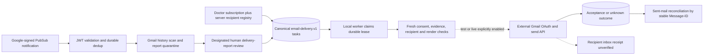

# Email delivery, subscriptions and reconciliation

This is part of the shared local application, not a separately deployed service.

[Component architecture, diagram, inputs/outputs, versions, entry points, canonical records, configuration, run/test steps and failure behavior](../../../../docs/architecture/email-delivery.md).

[Local setup](../../../../docs/demo/setup.md) · [Demo walkthrough](../../../../docs/demo/walkthrough.md) · [System overview](../../../../docs/architecture/overview.md).

Deliver an already validated newsletter only to a verified, explicitly authorized recipient with an active subscription. Gmail is an external email transport; it is never an inference provider.

**Files:** `delivery/{config.server,subscription.server,render,gmail.server,worker.server,webhook.server,notifications.server,mailbox.server,watch.server,events.server,types}.ts`; routes `/api/delivery/run`, `/api/email/unsubscribe`, `/api/email/gmail-webhook`, `/api/gmail-notifications/run`; `scripts/{authorize-gmail,configure-email-recipient,setup-gmail,review-gmail-report}.ts`. Shared doctor API exposes preferences/status; `NewsletterDelivery` shows them in the Library.

**Contracts/data:** `email-recipient.v1`, `email-delivery.v1`, `email-safe.v1`, `email-render.v1` in the canonical doctor document. `email_mailbox/gmail` holds notification/checkpoint/report state. OAuth secrets remain server-only. Recipient registry binds doctor UUID, recipient UUID, email, version, actual verified/authorized timestamps and allowed test/live modes; `configure-email-recipient.ts` publishes matching canonical metadata. This is operator-attested verification, not an implemented email challenge flow. Doctor subscription is separate; a changed recipient unsubscribes and cancels old tasks. Unsubscribe tokens are signed/versioned, with optional previous signing key; complaints/bounces suppress further work.

**Modes:** default `EMAIL_MODE=preview`, `EMAIL_SEND_ENABLED=false`; no Gmail sends. `test` and `live` both call the real Gmail API when enabled—test is not a Gmail sandbox. Require authorized mode, non-`.invalid` recipient, matching canonical metadata, OAuth sender config, subscription and HTTPS `APP_ORIGIN`. Preview HTTP origin renders links with `https://example.invalid`; these are intentionally not working article links. Email-safe rendering omits patient-mix values, practice codes and hospital assignments in HTML/text/metadata.

**OAuth/local HTTPS:** provision a Google OAuth client with Gmail API enabled and explicit sender consent to `gmail.send` and `gmail.readonly`. `authorize-gmail.ts` uses the loopback callback `http://127.0.0.1:8484/oauth/gmail`, opens a consent URL and stores ignored mode-0600 `.env.gmail.local`; it does not send email. Client type/redirect configuration must permit that callback. The app separately requires an HTTPS origin to send: use an operator-configured HTTPS reverse proxy/tunnel to local port 8081, set exact `APP_ORIGIN`, restart app/workers and sign in on that origin. No proxy/tunnel or certificate is bundled/verified. Thus localhost HTTP preview is supported now; full send remains blocked until this infrastructure and authorization exist. Public article links still require doctor sign-in.

**Delivery lifecycle:** stable newsletter/recipient/channel key, deterministic Message-ID and durable attempts/lease. One sending task per doctor. Recheck current subscription, recipient, consent/profile and KB immediately before send. Weekly/fortnightly cadence uses elapsed 7/14 days and is independent of reading. Five-attempt maximum, 24-hour retry window from send-not-before, backoffs 1/5/30/120 minutes. A sending lease abandoned after five minutes becomes unknown; unknown outcomes search sent mail by Message-ID up to five reconciliations. No search hit is not proof of no send; unknown is never automatically resent. Gmail does not enforce this application's idempotency key, so exactly-once transport is not promised.

**Outcomes:** `provider-accepted` means Gmail returned an accepted ID (or sent-mail lookup recovered it); it is not delivered/read. Recipient inbox inspection is needed for a demo receipt claim. Google-signed Pub/Sub notifications validate issuer/audience/service identity/subscription and deduplicate; they signal sender mailbox changes. History scanning quarantines delivery reports; a correlated report conservatively suppresses/holds work until designated human review, rather than trusting raw report text. `review-gmail-report.ts` records attested outcome evidence, not autonomous delivery proof. No tracking pixel or read-to-complete gate.

**Configuration:** `EMAIL_MODE`, `EMAIL_SEND_ENABLED`, `EMAIL_RECIPIENTS_JSON`, `EMAIL_UNSUBSCRIBE_SECRET`, optional `EMAIL_UNSUBSCRIBE_SECRET_PREVIOUS`; `GMAIL_CLIENT_ID`, `GMAIL_CLIENT_SECRET`, `GMAIL_REFRESH_TOKEN`, `GMAIL_SENDER`; required notification setup for sending `GMAIL_PUBSUB_TOPIC`, `GMAIL_PUBSUB_SUBSCRIPTION`, `GMAIL_PUBSUB_AUDIENCE`, `GMAIL_PUBSUB_SERVICE_ACCOUNT_EMAIL`, `EMAIL_DELIVERY_REVIEWER`; shared Databricks/auth/origin/cron variables. The current send gate requires signed Pub/Sub configuration and an acknowledged, unexpired canonical mailbox watch. These notifications remain mailbox-change signals, never delivery evidence. `setup-gmail.ts` provisions mailbox state; `--watch` creates a Gmail watch, not a send. Watch renewal is in the worker.

**Run/test/status:** [setup](../../../../docs/demo/setup.md) and [walkthrough](../../../../docs/demo/walkthrough.md). `npm test -- src/lib/msl/delivery src/lib/msl/newsletter/worker.integration.test.ts` exercises mocked provider failures, privacy, subscriptions, leases, ambiguous sends and webhook gates. Implementation exists; recorded receipts do not prove Gmail OAuth, a send or receipt. No email is sent during packaging. Provider reporting, local HTTPS and actual authorized inbox verification remain demo prerequisites; production hosting is outside scope.
