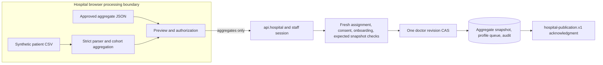

# Hospital aggregate publication

This is part of the shared local application, not a separately deployed service.

[Component architecture, diagram, inputs/outputs, versions, entry points, canonical records, configuration, run/test steps and failure behavior](../../../../docs/architecture/hospital-patient-sync.md).

[Local setup](../../../../docs/demo/setup.md) · [Demo walkthrough](../../../../docs/demo/walkthrough.md) · [System overview](../../../../docs/architecture/overview.md).

Hospital staff publish approved synthetic aggregates for assigned, currently consenting doctors. The active path is an aggregate-only upload, not a deployed raw-patient ETL pipeline.

**Files:** `src/routes/hospital.tsx`, `src/lib/msl/hospital/{service.server,publication.server,contract}.ts`, `src/lib/msl/patient-sync/contract.ts`. `simulation.server.ts` is an isolated test baseline; current route has no unauthenticated simulator fallback. [Detailed handoff](../../../../docs/PATIENT-SYNC.md).

**Input/output:** strict `patientUploadSchema` fields: `doctor_id_code`, `synced_at`, `panel_size`, `min_cell_size`, allowlisted `aggregates` percentages/null. HTTP input pins request UUID, source kind and expected prior snapshot ID. Success contains snapshot ID/version and `hospital-publication.v1` workspace/hospital/doctor provenance plus `canonical_revision`. This is saved in the doctor record's `patient_mix` and `sync_history`; a new profile and audit are committed together.

**Cohorts:** supplied synthetic CSV format only, 5–50,000 rows, unique `SYN-*` IDs and one doctor panel; 5 MB file maximum. Denominator is that uploaded panel, not an inferred complete clinical population. Exact synthetic rules count NSCLC/SCLC, observed EGFR/KRAS/ALK/PD-L1, prior osimertinib, its MET intersection, Stage IV/Extensive and SCLC maintenance marker. The chemo-IO label does not independently verify the regimen. Counts under 5 are null; unknown/suppressed values remain unknown. JSON accepts a panel of 5–1,000,000 and minimum cell size >=5; positive rounded percentages must pass its suppression gate. Overlapping marginal percentages are never multiplied into eligibility estimates.

**Trigger/failure:** manual staff publication checks consent and assignment afresh, then canonical CAS acknowledges. Reusing the same UUID recovers an ambiguously committed snapshot without another job/audit; changed expectations or stale timestamps fail. HTTP 503 means unconfirmed, potentially committed, not safe to announce success. Unlink denies uploads/use; relink cannot activate an old snapshot. Staff cannot consent or confirm on behalf of a doctor.

**Configuration:** shared session/origin/Databricks settings; no active `HOSPITAL_SYNC_MODE` setting. Raw rows, credentials and files never enter app/model storage. The backend receives strict approved aggregate values, not the CSV.

**Run/test:** use `/hospital`, select an assigned consenting doctor, use its built-in demo panel or [synthetic aggregate fixture](../../../../fixtures/synthetic-hospital-aggregate.json), preview/authorize and publish. No 180-row source CSV or generator is packaged; old handoff references to a supplied CSV refer to earlier external material. The built-in panel/JSON is the reproducible path here. `npm test -- src/lib/msl/hospital src/lib/msl/patient-sync` covers acknowledgment, ambiguous commits, idempotency, consent and UI. Prior live verification was read-only; no live aggregate upload is inferred from those tests.
