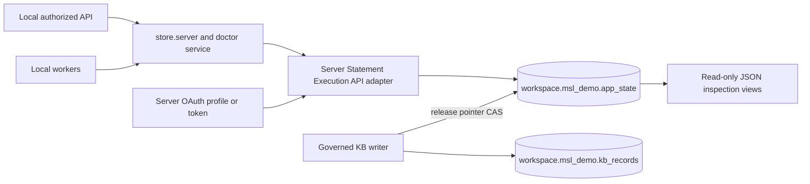

# Databricks platform and storage

This is part of the shared local application, not a separately deployed service.

[Component architecture, diagram, inputs/outputs, versions, entry points, canonical records, configuration, run/test steps and failure behavior](../../../../docs/architecture/databricks-platform.md).

[Local setup](../../../../docs/demo/setup.md) · [Demo walkthrough](../../../../docs/demo/walkthrough.md) · [System overview](../../../../docs/architecture/overview.md).

The platform owns server authentication, constrained SQL transport and authoritative doctor-document writes. Databricks is the only active domain authority; local fixture stores and Supabase are not connected fallbacks.

**Verified resources in recorded handoffs:** workspace `7474660613250664`, host `https://dbc-85372395-9d08.cloud.databricks.com`, warehouse `bccde8ce8d366533`, tables `workspace.msl_demo.app_state` and `workspace.msl_demo.kb_records`. No console automation. Inspection views include `doctor_profiles`, `doctor_patient_context`, `doctor_audit_history`, `doctor_matching_runs`, `doctor_newsletters` and `kb_<kind>`.

**Files/contracts:** `src/integrations/databricks/sql.server.ts`, `model-hosting.server.ts`; `src/lib/msl/platform/{types,store.server,auth.server,doctor.server,profile-state}.ts`; `scripts/setup-databricks.ts`. App rows are `record_type,id,revision,payload,updated_at`. Doctor payloads use `msl-app-state.v1`; `kb_release/published` carries envelope plus `matching-kb.v1`. Email notifications use `email_mailbox/gmail`. KB immutable records have `record_type,id,version,content_hash,payload,created_at`.

**Ownership:** app server/workers write doctor documents. Governed KB service/CLI owns immutable KB and pointer; matching only reads it. Single-writer bootstrap preserves existing rows. Readers reject duplicate IDs; Delta primary-key uniqueness is not assumed. Doctor writes require the expected UUID revision and exactly one affected row. State and audit commit in one doctor CAS; prior audit prefix is immutable in application code. Serializable isolation/change data feed support inspection, not protection against privileged administrator changes. KB append-only Delta rejects update/delete; governed pointer leases fence cooperating writers.

**Bounds:** doctor JSON <=2,000,000 bytes; directories reject 999 or more records; SQL transport requests <=1,000 rows / 8 MB and rejects truncation or extra chunks. The same document carries growing history, so archival is needed before scale. No distributed transaction joins doctor, KB and external email. Ambiguous SQL timeouts require readback and operation-specific idempotent recovery; do not blindly replay an arbitrary mutation.

**Configuration:** `DATABRICKS_HOST`, `DATABRICKS_WAREHOUSE_ID`, `DATABRICKS_APP_TABLE`, `DATABRICKS_AUTH_PROFILE` for local CLI OAuth or server-only `DATABRICKS_TOKEN`; `KB_NAMESPACE` defaults to `workspace.msl_demo`. Production-mode code disables CLI token lookup. Accounts/secrets remain outside analytical tables; domain recipient metadata is canonical, OAuth credentials are not.

**Rationale:** a small JSON document keeps consent/state/jobs/outbox/audit together and reduces migration complexity. SQL parameters keep user data out of SQL syntax. Costs include row contention, bounded full-document reads and no database schema enforcement of JSON business rules. This is a local demo design, not a production storage recommendation.

**Run/test:** [setup](../../../../docs/demo/setup.md), `npm test`, `npx tsc --noEmit`. SQL/store/auth tests use injected fixtures; live setup/check scripts are separate deliberate operations. Prior handoffs verify canonical read/write and profiles; packaging does not repeat live writes. Least-privilege hosted identities, archival and shared rate limits remain future work.
